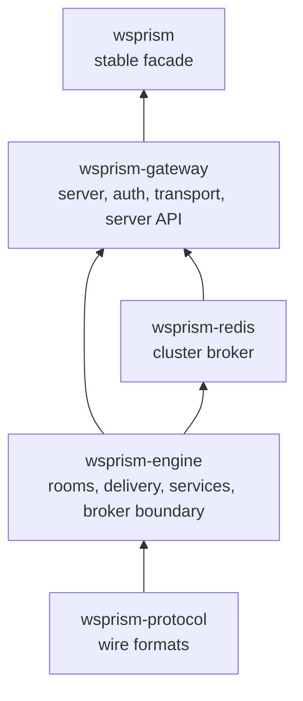
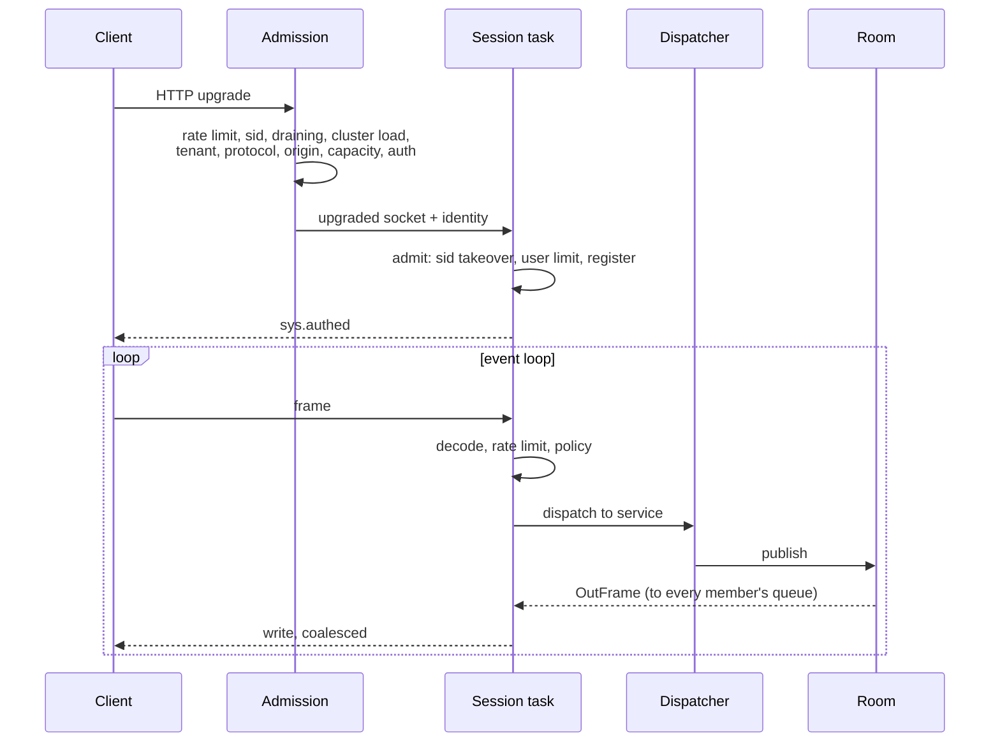

# Architecture Overview

This chapter follows a message through the gateway and explains the structures it passes on the way. It is written for contributors, and for operators who want to know why the gateway behaves the way it does under load.

## Crates

- **`wsprism-protocol`** knows the wire formats and nothing else: envelopes, Hot frames, error and close codes. It has no runtime dependencies and is fuzzed.
- **`wsprism-engine`** is the realtime core: sessions' contexts, rooms, delivery classes, Hot slots, service traits, the dispatcher, and the `Broker` boundary. It knows nothing about HTTP, axum or the configuration format.
- **`wsprism-redis`** implements `Broker` on Redis.
- **`wsprism-gateway`** is the server: configuration, admission, authentication, the WebSocket transport, the server API, the RPC and connect proxies, metrics and logging. It also builds the binary.
- **`wsprism`** is the facade users depend on. It re-exports what is stable and nothing else.

The point of the split is that each layer can be replaced without disturbing the ones below it. A new transport touches the gateway's transport module. A new broker implements one trait. A different server could be built on the engine without touching the protocol.

## The life of a connection

### Admission

Admission is a pipeline of small checks, each returning either success or a typed rejection that becomes an HTTP status, a `Retry-After` header and a metric label. The checks are ordered cheapest first, and authentication comes last, so that a connection refused for any other reason costs no signature check, no backend call and no one-time ticket. Adding a rule means adding a step, not editing the upgrade handler.

### Registration

After the upgrade, the session registers itself under its tenant and user. Same-`sid` replacement, the per-user limit (deny or evict the oldest), the tenant cap and the insertion all happen under one lock on the user's entry, so concurrent connections for the same user cannot slip past each other. In a cluster, a Redis script makes the same decision across nodes, and an eviction that targets a session not yet registered locally is remembered and enforced when that session arrives.

### The event loop

Each session runs on one task, in a single `select!` loop over five sources:

- frames from the client;
- the outbound queue, fed by rooms and services;
- the Hot slot, which holds the newest keyed state per sender and key;
- close requests from other tasks (kicks, replacement, drain, slow consumer, idle);
- the result of an in-band credential refresh.

The loop never awaits its own outbound queue. A handler that wants to send places a frame on the queue with `try_send`, and if the queue is full, the delivery class decides what happens. That rule rules out a whole family of deadlocks in which a session waits for itself.

Room membership changes only on the session's own task, so the service context is passed to services as `&mut` and needs no lock on the hot path.

### Inbound

A text frame is decoded into an envelope, checked against the connection's rate limiter and the tenant's allowlist, and handed to the dispatcher, which looks the service up by name. A binary frame follows the same path keyed by service id and opcode. Decoding Hot frames is zero-copy and costs about 20 ns regardless of size; a policy check costs 5 to 18 ns.

RPC calls to your backend run on their own tasks, so a slow backend never stalls the session.

### Fan-out

A room holds, for each member, a direct handle to that member's delivery queue. Publishing to a room is therefore a walk over a list of handles with no registry lookups and no string copies. A message is serialised once, and the same bytes are shared by every recipient: server-to-client WebSocket frames are not masked, so every member's copy is identical.

### Outbound

The writer takes the first frame from the queue, then whatever else is already waiting (up to a batch limit), and flushes them with one system call. Coalescing writes this way is the main reason CPU per delivery falls as load rises.

A write that blocks longer than `writer_send_timeout_ms` closes the session. The timer is armed only when a write actually blocks, which removed a timer registration from every write.

Hot state does not go through the queue. A per-session slot table keeps the newest frame per `(sender, svc, key)`; the event loop drains it when signalled, or on the tenant's tick if `hot_tick_hz` is set. A slow reader therefore always gets the latest state, and the table's size bounds the memory a slow reader can cost.

### The transport seam

The event loop talks to the socket through two traits, `SessionTx` and `SessionRx`. Only one module knows axum's WebSocket types. That seam is where a WebTransport implementation will plug in, and the outbound frame type (`OutFrame`) was made transport-agnostic early for the same reason.

## Delivery classes

| Class | Queue full | Used by |
|---|---|---|
| Reliable | The recipient is closed as a slow consumer (4101) and resumes from history on reconnect | Ext messages, replies, presence events |
| Lossy | Dropped for that recipient, counted | Hot frames without a key, lossy server publishes |
| Keyed Hot | Replaced by the newer value in the slot table | Hot frames with a key |

The asymmetry is deliberate. A reliable message that is silently dropped breaks the ordering promise, and the client cannot tell. A closed connection is visible, and the history mechanism makes it cheap to recover from.

## The broker boundary

All room traffic leaves the engine through the `Broker` trait. The in-memory broker delivers locally. The Redis broker adds:

- an **outbox**: a queue of frames bound for Redis, with per-tenant shares, retried in order and refused once it is full or its oldest frame is too old;
- subscriptions per room, spread over several subscriber connections;
- shared stores for sessions, presence, tickets and history.

The engine's ordering rules are written against the trait, not against Redis, and the test suite runs the same scenarios against both brokers. The [next chapter](cluster-internals.md) describes the Redis broker in detail.

## Memory per connection

An idle connection costs about 16 KB of process memory, and 18 to 28 KB under load in room workloads. Most of it is WebSocket read buffering and the session's task and queue. The first baseline was about 28 KB idle. The main savings came from replacing nested concurrent sets with plain per-session structures and from letting rooms hold delivery handles directly. Swapping the global allocator for mimalloc was measured and rejected: it saved no CPU and up to doubled memory under load.

## Errors and panics

Production code contains no `unwrap`, `expect` or `panic!`; lints enforce it. Errors that reach a client carry a code from a fixed set and never reveal internal causes. The parsers that see untrusted input (envelopes, Hot frames, the subprotocol header, origins, `X-Forwarded-For`) are fuzzed in CI.
