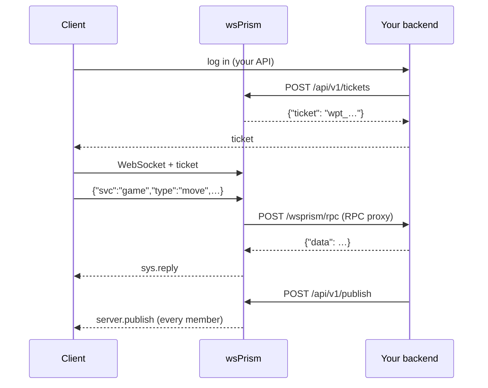

# Connecting Your Backend

wsPrism is meant to sit in front of a backend you already have, written in whatever language you already use. The two talk over plain HTTP in both directions:



- **Your backend calls the gateway** through the server API: tickets, publishing, disconnecting users, reading presence.
- **The gateway calls your backend** through the connect proxy (who may connect) and the RPC proxy (requests clients send for your services).

## The server API

The server API listens on its own address, separate from the public WebSocket port. Bind it to loopback or a private network; it should never face the internet.

```yaml
gateway:
  api:
    listen: "127.0.0.1:8081"
tenants:
  - id: acme
    api_keys:
      - name: backend
        sha256: "3b4c…"     # printf %s "$KEY" | sha256sum
```

Only the SHA-256 of each key is stored in configuration. Requests send the key as `Authorization: Bearer <key>`, and the key decides the tenant: a backend cannot act on a tenant whose key it does not hold. Give each backend service its own key with a descriptive `name`, so that rotation and logs stay readable.

The endpoints are summarised here and specified in [Server API](../reference/server-api.md).

### Publishing

```bash
curl -X POST http://127.0.0.1:8081/api/v1/publish \
  -H "Authorization: Bearer $KEY" \
  -d '{"room":"match:42","data":{"event":"goal","by":"alice"}}'
# {"recipients": 12}
```

Members receive `{"v":1,"svc":"server","type":"publish","room":"match:42","data":{…}}`. Ext publishes are reliable unless you pass `"qos": "lossy"`. A `hot` body publishes a binary frame instead (see [The Hot Lane](hot-lane.md)).

`recipients` counts members on the node that took the request. In a cluster, members on other nodes receive the message too but are not counted. A 200 means the message was accepted and queued, not that it was delivered. If you need to know that every client saw a message, publish to a history room and check the offsets your clients report.

A node that is shutting down, or whose queue to Redis is full, answers 503 with `Retry-After`. Retry on another node or through your load balancer. If a retry might duplicate a message that matters, put an id in the message so clients can recognise it.

### Disconnecting users

```bash
curl -X POST http://127.0.0.1:8081/api/v1/disconnect \
  -H "Authorization: Bearer $KEY" \
  -d '{"user":"alice","reason":"account suspended"}'
# {"closed": 2}
```

Without `sid`, every session of the user is closed; with it, only that one. The client receives `sys.kicked` with your reason and close code 4007, which tells the SDK not to reconnect. In a cluster the command reaches every node.

### Presence

```bash
curl http://127.0.0.1:8081/api/v1/rooms/match:42/presence -H "Authorization: Bearer $KEY"
# {"room":"match:42","users":["alice","bob"]}
```

### Tickets

`POST /api/v1/tickets` was covered in [Authentication](authentication.md#one-time-tickets).

## The RPC proxy

The RPC proxy lets clients send requests that your backend answers, without your backend holding a single socket. Ext messages whose `svc:type` matches `allow` are forwarded to your endpoint:

```yaml
tenants:
  - id: acme
    rpc:
      url: "http://10.0.0.5:9000/wsprism/rpc"
      allow: ["game:*", "shop:buy"]
      timeout_ms: 5000
      max_in_flight: 16          # per connection
      max_in_flight_total: 1024  # per tenant
      secret_env: BACKEND_SECRET
    policy:
      ext_allowlist: ["room:*", "game:*", "shop:buy"]
```

Two lists appear here, and both are needed: `rpc.allow` decides *where* a message goes, `ext_allowlist` decides *whether* it is permitted at all. Built-in services (`room`, `chat`, `sys`) cannot be routed.

A client request

```json
{"v":1,"svc":"game","type":"move","room":"match:42","seq":9,"data":{"x":3,"y":1}}
```

becomes

```json
POST /wsprism/rpc
Authorization: Bearer <BACKEND_SECRET>

{"tenant":"acme","user":"alice","sid":"tab-1","svc":"game","type":"move",
 "room":"match:42","joined":true,"data":{"x":3,"y":1}}
```

and your answer is relayed back:

| Your reply | Client receives |
|---|---|
| `200 {"data": …}` | `sys.reply` with that `data` and `reply_to: 9` |
| `200 {"error": {"code": "NOT_YOUR_TURN", "msg": "…"}}` | `sys.error` with that code (`[A-Z0-9_]{1,32}`, otherwise `RPC_ERROR`) |
| anything else, a timeout, or no answer | `sys.error UNAVAILABLE`; your body is never forwarded |

`user` and `sid` come from the authenticated session; the client cannot forge them. By default a request naming a room the session has not joined is refused before it reaches you (`NOT_ALLOWED`), so `"joined": true` is a fact you can rely on. With `require_joined_room: false` such requests are forwarded with `"joined": false`, and then the room is only a claim.

The session never waits for your backend. Each call runs on its own task while other messages keep flowing, which means replies can arrive out of order relative to other replies. Clients correlate by `seq`. A connection with more than `max_in_flight` calls pending gets `RATE_LIMITED` immediately; a tenant over `max_in_flight_total` gets `RESOURCE_EXHAUSTED`.

A common pattern: the backend answers the caller *and* broadcasts the outcome to the room with `/api/v1/publish`. The example application does this with a dice roll.

## How the gateway calls you

The connect proxy and the RPC proxy share one HTTP client per process, with deliberately conservative behaviour:

- it never follows redirects, so a token cannot be carried to a host the configuration did not name;
- it ignores `HTTP_PROXY` and `HTTPS_PROXY` in the environment;
- it reads at most 1 MiB of any reply;
- it verifies `https` against the operating system's certificate store. A private CA installed on the host is trusted; minimal container images need the `ca-certificates` package.

With `secret_env`, the gateway sends the variable's value as `Authorization: Bearer …`, so your endpoint can tell the gateway apart from anything else on the network. Logs show backend URLs without credentials and with query values masked.

## Writing services in Rust instead

When a round trip to your backend is too slow, for example game logic on the Hot lane, write the service in Rust and register it with `Gateway::builder`. It runs inside the gateway with direct access to rooms. See [Rust API](../reference/rust-api.md).
