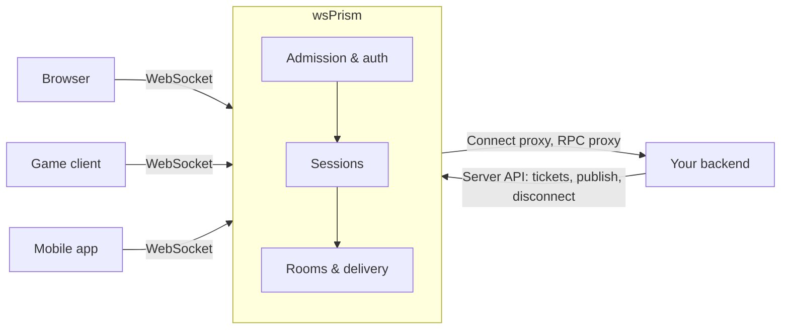

# Introduction

**wsPrism** is a realtime gateway written in Rust. It sits between your clients and your backend and takes on the part of a realtime application that ordinary web servers handle poorly: hundreds of thousands of long-lived connections, rooms, fan-out, presence, and the bookkeeping that keeps all of it consistent when machines fail.

Your backend stays an ordinary HTTP service. It decides who may connect, publishes to rooms, and answers requests; wsPrism keeps the sockets.

## Why a gateway

Request-response backends are built around short work and shared-nothing processes. A persistent connection is the opposite: it lives for hours, holds state, and must be woken the moment anything happens in a room it belongs to. Putting those connections inside the application server couples two very different scaling problems, and the connection side usually wins the argument about which hardware you buy.

wsPrism separates them. Connections, rooms and delivery live in one dedicated process (or a few of them, sharing state through Redis). Business logic stays where it already is.

## What it gives you

- **Two lanes on one connection.** JSON messages for chat, commands and anything request-shaped; compact binary frames for state that changes many times a second, where only the latest value matters.
- **Multi-tenancy.** One deployment serves several isolated tenants, each with its own authentication, allowlists, rate limits and resource limits.
- **Authentication that fits your stack.** One-time tickets issued by your backend, JWTs (including JWKS and key rotation), a connect proxy that asks your backend, or a plugin of your own. Credentials can be renewed in-band without reconnecting.
- **Rooms with history.** Clients that drop and come back receive what they missed, in order, or are told plainly that the gap cannot be filled.
- **A cluster that tells the truth.** Several nodes share rooms, sessions, presence and history through Redis. Failures are handled explicitly: lost messages are announced, a node that lost its place stops instead of corrupting state, and the behaviour is tested against killed nodes, network partitions and Redis restarts.
- **Measured performance.** Against Centrifugo on the same machine, wsPrism holds a connection in a quarter to a third of the memory in busy small rooms and about half with 50,000 mostly idle connections, spends less CPU per delivery at low and medium load, and keeps p99 latency under 10 ms at two million deliveries a second. With TLS terminated by the gateway itself (`gateway.tls`) the advantage holds: 1.25 to 1.5 times less CPU and 1.8 to 3.4 times less memory than Centrifugo's built-in TLS. The [benchmarks](project/benchmarks.md) explain how this was measured and where the comparison stops being fair.

## When it is a good fit

wsPrism suits applications where connections are numerous and long-lived and the server has to push: multiplayer games and shared-state applications, collaborative tools, live dashboards, chat and notifications, trading screens. It is a good choice when memory per connection and tail latency matter, and when you would rather operate one well-behaved process than embed connection handling in every backend service.

It is not a message queue, a database or a general-purpose RPC framework, and it does not speak existing protocols such as Socket.IO or Pusher. Clients use the wsPrism protocol, through the JavaScript SDK or a client of your own.

## Status

wsPrism is approaching its first public release (0.1.0). The single-node gateway is complete and extensively tested. The Redis cluster is feature-complete and survives the failure tests described in this book, but it is labelled **experimental** until it has run in production. See the [roadmap](project/roadmap.md) for what comes next.

## Where to go next

- [Design Philosophy](philosophy.md) explains the principles behind the decisions.
- [Getting Started](getting-started.md) runs a gateway and connects a client in a few minutes.
- [Core Concepts](guide/concepts.md) introduces the vocabulary used throughout the guide.
