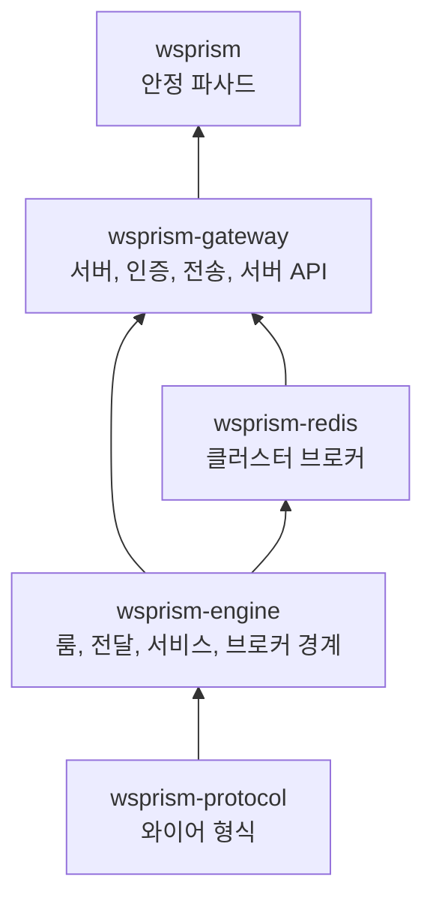
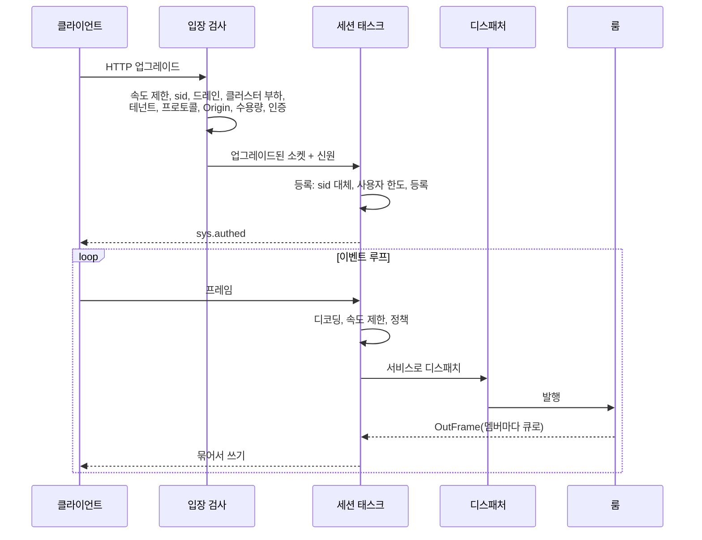

# 구조 개요

메시지 하나가 게이트웨이를 지나가는 길을 따라가며, 그 길에서 만나는 구조를 설명합니다. 기여자를 위한 장이지만, 부하가 걸렸을 때 게이트웨이가 왜 그렇게 움직이는지 궁금한 운영자에게도 도움이 됩니다.

## 크레이트

- **`wsprism-protocol`**은 와이어 형식만 압니다. 봉투, Hot 프레임, 오류 코드와 종료 코드입니다. 런타임 의존성이 없고 퍼징을 거칩니다.
- **`wsprism-engine`**은 실시간 코어입니다. 세션 컨텍스트, 룸, 전달 등급, Hot 슬롯, 서비스 트레이트, 디스패처, `Broker` 경계가 여기 있습니다. HTTP도, axum도, 설정 형식도 모릅니다.
- **`wsprism-redis`**는 `Broker`를 Redis로 구현합니다.
- **`wsprism-gateway`**는 서버입니다. 설정, 입장 검사, 인증, WebSocket 전송, 서버 API, RPC·connect 프록시, 메트릭과 로그를 맡고 바이너리도 만듭니다.
- **`wsprism`**은 사용자가 의존하는 파사드입니다. 안정적인 것만 다시 내보냅니다.

이렇게 나눈 이유는 층마다 아래층을 건드리지 않고 바꿀 수 있게 하려는 것입니다. 새 전송은 게이트웨이의 전송 모듈만 건드립니다. 새 브로커는 트레이트 하나만 구현하면 됩니다. 프로토콜을 건드리지 않고 엔진 위에 다른 서버를 만들 수도 있습니다.

## 연결의 일생

### 입장 검사

입장 검사는 작은 검사들을 이은 파이프라인입니다. 각 검사는 성공이나, HTTP 상태·`Retry-After`·메트릭 레이블이 되는 타입 있는 거절을 돌려줍니다. 가벼운 검사부터 돌고 인증은 맨 끝이라, 다른 이유로 거절될 연결이 서명 검증이나 백엔드 호출이나 1회용 티켓을 쓰는 일이 없습니다. 규칙을 더할 때는 단계를 하나 끼우면 되고, 업그레이드 처리부를 고칠 필요가 없습니다.

### 등록

업그레이드가 끝나면 세션은 테넌트와 사용자 아래에 자신을 등록합니다. 같은 `sid` 대체, 사용자당 한도(거절 또는 가장 오래된 세션 축출), 테넌트 상한, 삽입이 모두 그 사용자 항목의 락 하나 아래에서 일어나므로, 같은 사용자의 동시 연결이 서로를 비껴가는 일이 없습니다. 클러스터에서는 Redis 스크립트가 노드 전체를 놓고 같은 판정을 하고, 아직 로컬에 등록되지 않은 세션을 겨냥한 축출은 기록해 두었다가 그 세션이 도착할 때 집행합니다.

### 이벤트 루프

세션마다 태스크 하나에서 `select!` 루프 하나가 다섯 가지 입력을 기다립니다.

- 클라이언트가 보낸 프레임
- 룸과 서비스가 채우는 송신 큐
- 송신자·키마다 가장 새 상태를 담아 두는 Hot 슬롯
- 다른 태스크가 보낸 종료 요청(강제 종료, 대체, 드레인, 느린 소비자, 유휴)
- 연결 중 자격 증명 갱신의 결과

루프는 자기 송신 큐를 절대 기다리지 않습니다. 보내려는 핸들러는 `try_send`로 큐에 프레임을 넣고, 큐가 가득 차면 전달 등급에 따라 처리합니다. 이 규칙 하나로 세션이 자기 자신을 기다리는 교착 상태가 통째로 사라집니다.

룸 멤버십은 세션 자신의 태스크에서만 바뀌므로, 서비스 컨텍스트를 `&mut`로 넘기고 핫 패스에서는 락이 필요 없습니다.

### 들어오는 길

텍스트 프레임은 봉투로 디코딩되고, 연결의 속도 제한기와 테넌트 허용 목록을 거쳐 디스패처로 갑니다. 디스패처는 이름으로 서비스를 찾습니다. 바이너리 프레임은 서비스 ID와 opcode로 같은 길을 갑니다. Hot 프레임 디코딩은 복사가 없어서 크기와 상관없이 약 20 ns이고, 정책 검사는 5~18 ns입니다.

백엔드로 가는 RPC 호출은 별도 태스크에서 돌기 때문에, 백엔드가 느려도 세션은 멈추지 않습니다.

### 팬아웃

룸은 멤버마다 그 멤버의 전달 큐를 가리키는 핸들을 직접 들고 있습니다. 그래서 룸에 발행하는 일은 레지스트리 조회도 문자열 복사도 없이 핸들 목록을 한 번 도는 것입니다. 메시지는 한 번만 직렬화하고, 같은 바이트를 모든 수신자가 함께 씁니다. 서버에서 클라이언트로 가는 WebSocket 프레임은 마스킹하지 않으므로 멤버마다 받는 바이트가 똑같기 때문입니다.

### 나가는 길

쓰기 쪽은 큐에서 첫 프레임을 꺼낸 뒤 이미 기다리고 있는 것들을 (묶음 한도까지) 더 꺼내서 시스템 콜 한 번으로 내보냅니다. 부하가 클수록 전달당 CPU가 줄어드는 주된 이유가 이 쓰기 묶음입니다.

쓰기가 `writer_send_timeout_ms`보다 오래 막히면 세션을 닫습니다. 타이머는 쓰기가 실제로 막혔을 때만 걸기 때문에, 쓰기마다 타이머를 등록하던 비용이 사라졌습니다.

Hot 상태는 큐를 거치지 않습니다. 세션마다 있는 슬롯 표가 `(sender, svc, key)`마다 가장 새 프레임을 담아 두고, 이벤트 루프는 신호를 받거나 `hot_tick_hz`가 정해져 있으면 틱마다 표를 비웁니다. 그래서 느린 수신자는 언제나 최신 상태를 받고, 느린 수신자가 차지할 수 있는 메모리는 표 크기로 묶입니다.

### 전송 경계

이벤트 루프는 `SessionTx`와 `SessionRx` 두 트레이트로만 소켓과 이야기합니다. axum의 WebSocket 타입을 아는 모듈은 하나뿐입니다. WebTransport 구현이 끼워질 자리가 여기이고, 송신 프레임 타입(`OutFrame`)을 일찍부터 전송과 무관하게 만든 것도 같은 이유에서입니다.

## 전달 등급

| 등급 | 큐가 가득 차면 | 쓰는 곳 |
|---|---|---|
| Reliable | 수신자를 느린 소비자로 닫고(4101), 재접속하면 이력으로 이어 받음 | Ext 메시지, 응답, 프레즌스 이벤트 |
| Lossy | 그 수신자에게만 버리고 셈 | 키 없는 Hot 프레임, 손실 허용 서버 발행 |
| 키 있는 Hot | 슬롯 표에서 새 값으로 대체 | 키 있는 Hot 프레임 |

이 비대칭은 의도한 것입니다. 신뢰 메시지를 조용히 버리면 순서 약속이 깨지는데, 클라이언트는 그걸 알 길이 없습니다. 연결이 닫히는 건 눈에 보이고, 이력 덕분에 싸게 회복할 수 있습니다.

## 브로커 경계

룸 트래픽은 모두 `Broker` 트레이트를 거쳐 엔진을 떠납니다. 메모리 브로커는 로컬에서 전달합니다. Redis 브로커는 여기에 다음을 더합니다.

- **아웃박스**: Redis로 갈 프레임 큐입니다. 테넌트별 몫이 있고, 순서대로 재시도하며, 가득 차거나 가장 오래된 프레임이 너무 오래 기다리면 거절합니다.
- 룸별 구독. 여러 구독 연결에 나눠 둡니다.
- 세션, 프레즌스, 티켓, 이력을 함께 쓰는 저장소

엔진의 순서 규칙은 Redis가 아니라 트레이트를 기준으로 짜여 있고, 시험도 같은 시나리오를 두 브로커에 모두 돌립니다. Redis 브로커는 [다음 장](cluster-internals.md)에서 자세히 다룹니다.

## 연결당 메모리

유휴 연결은 프로세스 메모리 약 16 KB를 쓰고, 룸 위주 부하에서는 18~28 KB입니다. 대부분은 WebSocket 읽기 버퍼와 세션의 태스크·큐입니다. 처음 기준선은 유휴 상태에서 약 28 KB였습니다. 중첩된 동시성 집합을 세션별 평범한 구조로 바꾸고, 룸이 전달 핸들을 직접 들게 한 것이 가장 크게 줄였습니다. 전역 할당자를 mimalloc으로 바꾸는 것도 재 보았지만 CPU는 그대로이고 부하 중 메모리가 최대 두 배가 돼서 채택하지 않았습니다.

## 오류와 패닉

운영 코드에는 `unwrap`, `expect`, `panic!`이 없으며 린트가 이를 강제합니다. 클라이언트에 닿는 오류는 정해진 코드 가운데 하나를 쓰고 내부 원인은 드러내지 않습니다. 신뢰할 수 없는 입력을 보는 파서(봉투, Hot 프레임, 서브프로토콜 헤더, Origin, `X-Forwarded-For`)는 CI에서 퍼징합니다.
