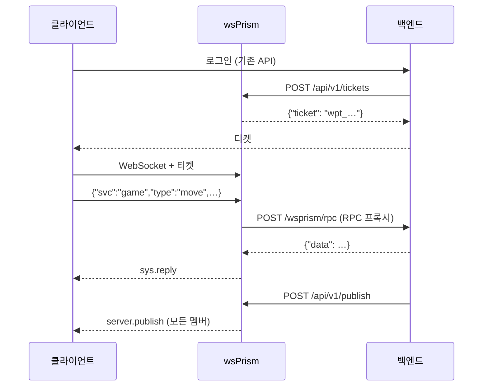

# 백엔드 연동

wsPrism은 이미 운영 중인 백엔드 앞에, 이미 쓰고 있는 언어 그대로 붙이도록 만들었습니다. 둘은 양방향 모두 평범한 HTTP로 이야기합니다.



- **백엔드가 게이트웨이를 부를 때**는 서버 API를 씁니다. 티켓 발급, 발행, 사용자 강제 종료, 프레즌스 조회입니다.
- **게이트웨이가 백엔드를 부를 때**는 connect 프록시(접속 허가)와 RPC 프록시(클라이언트가 내 서비스로 보낸 요청)를 씁니다.

## 서버 API

서버 API는 공개 WebSocket 포트와 따로, 자기 주소에서 열립니다. 루프백이나 사설망에 바인딩하고 인터넷에는 절대 노출하지 마세요.

```yaml
gateway:
  api:
    listen: "127.0.0.1:8081"
tenants:
  - id: acme
    api_keys:
      - name: backend
        sha256: "3b4c…"     # printf %s "$KEY" | sha256sum
```

설정에는 키의 SHA-256만 적습니다. 요청은 키를 `Authorization: Bearer <key>`로 보내고, 어느 테넌트인지는 키로 정해집니다. 백엔드는 키를 받은 테넌트의 일만 할 수 있습니다. 백엔드 서비스마다 키를 따로 주고 `name`을 알아보기 쉽게 붙여 두면 키를 교체할 때나 로그를 볼 때 편합니다.

엔드포인트는 여기서 간단히 소개하고, 자세한 명세는 [서버 API](../reference/server-api.md)에 있습니다.

### 발행

```bash
curl -X POST http://127.0.0.1:8081/api/v1/publish \
  -H "Authorization: Bearer $KEY" \
  -d '{"room":"match:42","data":{"event":"goal","by":"alice"}}'
# {"recipients": 12}
```

멤버들은 `{"v":1,"svc":"server","type":"publish","room":"match:42","data":{…}}`를 받습니다. Ext 발행은 `"qos": "lossy"`를 주지 않는 한 신뢰 전달입니다. 본문에 `hot`을 담으면 바이너리 프레임을 보냅니다([Hot 레인](hot-lane.md) 참고).

`recipients`는 요청을 받은 노드에 있는 멤버 수입니다. 클러스터에서는 다른 노드의 멤버도 메시지를 받지만 이 숫자에는 들어가지 않습니다. 200은 메시지를 받아 큐에 넣었다는 뜻이지, 전달을 마쳤다는 뜻이 아닙니다. 모든 클라이언트가 봤는지 꼭 알아야 한다면 이력이 있는 룸에 발행하고 클라이언트가 알려 주는 offset을 확인하세요.

종료 중인 노드나 Redis로 가는 큐가 가득 찬 노드는 503과 `Retry-After`로 답합니다. 다른 노드나 로드밸런서를 거쳐 다시 보내세요. 재시도 때문에 중요한 메시지가 두 번 갈 수 있다면 메시지에 ID를 넣어 클라이언트가 알아보게 하세요.

### 사용자 내보내기

```bash
curl -X POST http://127.0.0.1:8081/api/v1/disconnect \
  -H "Authorization: Bearer $KEY" \
  -d '{"user":"alice","reason":"account suspended"}'
# {"closed": 2}
```

`sid`를 빼면 그 사용자의 세션을 모두 닫고, 주면 그 세션 하나만 닫습니다. 클라이언트는 지정한 사유가 담긴 `sys.kicked`와 종료 코드 4007을 받으며, SDK는 이 코드를 보고 재접속하지 않습니다. 클러스터에서는 모든 노드에 명령이 전달됩니다.

### 프레즌스

```bash
curl http://127.0.0.1:8081/api/v1/rooms/match:42/presence -H "Authorization: Bearer $KEY"
# {"room":"match:42","users":["alice","bob"]}
```

### 티켓

`POST /api/v1/tickets`는 [인증과 권한](authentication.md#1회용-티켓)에서 다뤘습니다.

## RPC 프록시

RPC 프록시를 쓰면 백엔드가 소켓을 하나도 들지 않고 클라이언트 요청에 답할 수 있습니다. `svc:type`이 `allow`에 맞는 Ext 메시지를 백엔드 엔드포인트로 넘깁니다.

```yaml
tenants:
  - id: acme
    rpc:
      url: "http://10.0.0.5:9000/wsprism/rpc"
      allow: ["game:*", "shop:buy"]
      timeout_ms: 5000
      max_in_flight: 16          # 연결당
      max_in_flight_total: 1024  # 테넌트 전체
      secret_env: BACKEND_SECRET
    policy:
      ext_allowlist: ["room:*", "game:*", "shop:buy"]
```

목록이 두 개 나오는데 둘 다 필요합니다. `rpc.allow`는 메시지를 *어디로* 보낼지, `ext_allowlist`는 그 메시지를 *받아 줄지*를 정합니다. 내장 서비스(`room`, `chat`, `sys`)는 백엔드로 넘길 수 없습니다.

클라이언트가 이렇게 요청하면

```json
{"v":1,"svc":"game","type":"move","room":"match:42","seq":9,"data":{"x":3,"y":1}}
```

백엔드에는 이렇게 갑니다.

```json
POST /wsprism/rpc
Authorization: Bearer <BACKEND_SECRET>

{"tenant":"acme","user":"alice","sid":"tab-1","svc":"game","type":"move",
 "room":"match:42","joined":true,"data":{"x":3,"y":1}}
```

백엔드의 답은 다음처럼 클라이언트에게 전달됩니다.

| 백엔드 응답 | 클라이언트가 받는 것 |
|---|---|
| `200 {"data": …}` | 그 `data`와 `reply_to: 9`가 담긴 `sys.reply` |
| `200 {"error": {"code": "NOT_YOUR_TURN", "msg": "…"}}` | 그 코드가 담긴 `sys.error`(`[A-Z0-9_]{1,32}`가 아니면 `RPC_ERROR`) |
| 그 밖의 응답, 시간 초과, 무응답 | `sys.error UNAVAILABLE`. 백엔드 응답 본문은 넘기지 않습니다 |

`user`와 `sid`는 인증을 통과한 세션에서 가져오므로 클라이언트가 위조할 수 없습니다. 기본적으로 세션이 들어가 있지 않은 룸을 적은 요청은 백엔드에 닿기 전에 `NOT_ALLOWED`로 거절합니다. 그러니 `"joined": true`는 믿어도 되는 사실입니다. `require_joined_room: false`로 두면 이런 요청도 `"joined": false`를 달고 넘어가며, 이때 룸은 클라이언트의 주장일 뿐입니다.

세션은 백엔드를 기다리지 않습니다. 호출마다 별도 태스크에서 돌고 다른 메시지는 계속 흐르므로, 응답 순서가 다른 응답과 뒤바뀔 수 있습니다. 클라이언트는 `seq`로 짝을 맞춥니다. 한 연결에서 대기 중인 호출이 `max_in_flight`를 넘으면 곧바로 `RATE_LIMITED`를, 테넌트 전체가 `max_in_flight_total`을 넘으면 `RESOURCE_EXHAUSTED`를 받습니다.

자주 쓰는 패턴은 백엔드가 요청한 사람에게 답하면서 동시에 `/api/v1/publish`로 결과를 룸 전체에 알리는 것입니다. 예제 앱의 주사위가 이렇게 동작합니다.

## 게이트웨이가 백엔드를 부르는 방식

connect 프록시와 RPC 프록시는 프로세스마다 HTTP 클라이언트 하나를 함께 쓰며, 일부러 보수적으로 동작하게 했습니다.

- 리다이렉트를 따라가지 않습니다. 토큰이 설정에 없는 호스트로 흘러가지 않게 하려는 것입니다.
- 환경의 `HTTP_PROXY`, `HTTPS_PROXY`를 무시합니다.
- 응답은 최대 1 MiB까지만 읽습니다.
- `https`는 운영체제 인증서 저장소로 검증합니다. 호스트에 설치한 사설 CA를 신뢰하며, 최소 구성의 컨테이너 이미지에는 `ca-certificates` 패키지가 있어야 합니다.

`secret_env`를 지정하면 그 변수의 값을 `Authorization: Bearer …`로 보내므로, 백엔드는 같은 네트워크의 다른 요청과 게이트웨이를 구별할 수 있습니다. 로그에 남는 백엔드 URL에서는 자격 증명을 빼고 쿼리 값은 가립니다.

## Rust로 서비스를 쓰는 경우

게임 로직을 Hot 레인에서 돌리는 경우처럼 백엔드 왕복조차 너무 느리다면, Rust로 서비스를 만들어 `Gateway::builder`로 등록하세요. 게이트웨이 안에서 돌면서 룸에 직접 접근합니다. [Rust API](../reference/rust-api.md)를 참고하세요.
