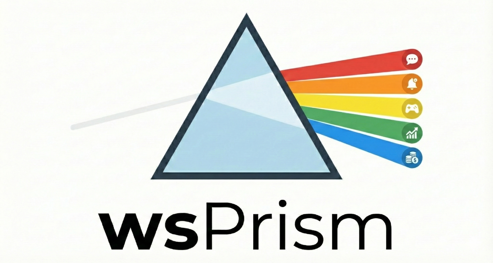
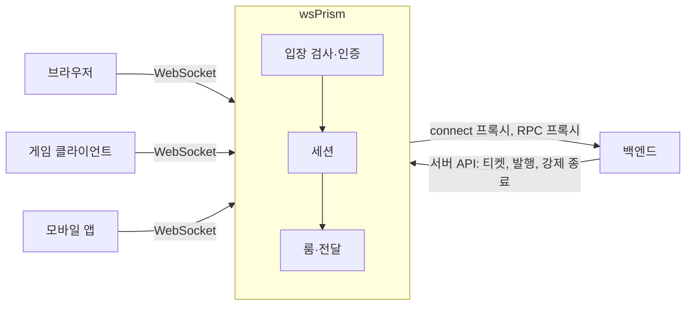

# 소개

**wsPrism**은 Rust로 만든 실시간 게이트웨이입니다. 클라이언트와 백엔드 사이에 서서, 평범한 웹 서버가 감당하기 어려운 일을 대신 맡습니다. 수십만 개의 오래 유지되는 연결, 룸, 팬아웃, 프레즌스, 그리고 장비가 죽어도 이 모든 상태를 어긋나지 않게 지키는 일입니다.

백엔드는 지금처럼 평범한 HTTP 서비스로 남습니다. 누가 접속할 수 있는지 정하고, 룸에 메시지를 보내고, 요청에 답하는 일은 백엔드가 하고, 소켓은 wsPrism이 붙잡고 있습니다.

## 왜 게이트웨이인가

요청-응답 방식의 백엔드는 짧게 끝나는 작업과 서로 상태를 나누지 않는 프로세스를 전제로 만들어집니다. 지속 연결은 정반대입니다. 몇 시간씩 살아 있고, 상태를 들고 있으며, 자기가 속한 룸에서 무슨 일이 생기면 그 즉시 깨어나야 합니다. 이런 연결을 애플리케이션 서버 안에 두면 성격이 전혀 다른 두 가지 확장 문제가 한 프로세스에 묶이고, 대개는 연결 쪽 사정이 서버 사양을 결정하게 됩니다.

wsPrism은 둘을 떼어 놓습니다. 연결, 룸, 전달은 전용 프로세스 하나가(필요하면 Redis로 상태를 나누는 여러 프로세스가) 맡고, 비즈니스 로직은 원래 있던 자리에 그대로 둡니다.

## 무엇을 해 주나

- **연결 하나에 레인 둘.** 채팅, 명령처럼 요청 성격의 메시지는 JSON으로, 초당 수십 번 바뀌어서 최신 값만 의미 있는 상태는 작은 바이너리 프레임으로 보냅니다.
- **멀티테넌시.** 한 배포에서 서로 격리된 테넌트 여럿을 운영합니다. 인증, 허용 목록, 속도 제한, 자원 한도를 테넌트마다 따로 둡니다.
- **지금 쓰는 인증 방식 그대로.** 백엔드가 발급하는 1회용 티켓, JWT(JWKS와 키 교체 포함), 백엔드에 직접 묻는 connect 프록시, 직접 만든 플러그인 가운데 고르면 됩니다. 자격 증명은 재접속 없이 연결 위에서 갱신합니다.
- **이력이 있는 룸.** 끊겼다 돌아온 클라이언트는 놓친 메시지를 순서대로 받습니다. 채울 수 없는 공백이면 그렇다고 분명히 알려 줍니다.
- **정직한 클러스터.** 여러 노드가 Redis를 통해 룸, 세션, 프레즌스, 이력을 함께 씁니다. 장애가 나면 감추지 않습니다. 잃은 메시지가 있으면 알리고, 자리를 빼앗긴 노드는 상태를 망가뜨리는 대신 스스로 멈춥니다. 노드 강제 종료, 네트워크 분할, Redis 재시작을 일부러 일으켜 이 동작을 시험합니다.
- **숫자로 확인한 성능.** 같은 장비에서 Centrifugo와 비교하면, 룸 위주 부하에서 연결 하나에 드는 메모리가 1/4~1/3이고, 저·중부하에서는 전달당 CPU도 적게 씁니다. 초당 200만 건을 전달할 때도 p99 지연이 10 ms를 넘지 않았습니다. 측정 방법과 비교가 공정하지 않은 지점은 [벤치마크](project/benchmarks.md)에 정리했습니다.

## 잘 맞는 곳

연결이 많고 오래 가며 서버가 먼저 밀어 줘야 하는 서비스에 잘 맞습니다. 멀티플레이 게임과 상태 공유형 앱, 협업 도구, 실시간 대시보드, 채팅과 알림, 트레이딩 화면 같은 것들입니다. 연결당 메모리와 꼬리 지연이 중요할 때, 그리고 백엔드 서비스마다 연결 처리를 끼워 넣기보다 잘 다듬어진 프로세스 하나를 운영하고 싶을 때 좋은 선택입니다.

메시지 큐도, 데이터베이스도, 범용 RPC 프레임워크도 아닙니다. Socket.IO나 Pusher 같은 기존 프로토콜과도 호환되지 않습니다. 클라이언트는 JavaScript SDK나 직접 만든 클라이언트로 wsPrism 프로토콜을 씁니다.

## 현재 상태

첫 공개 릴리스(0.1.0)를 앞두고 있습니다. 단일 노드 게이트웨이는 기능이 갖춰졌고 충분히 시험했습니다. Redis 클러스터도 기능은 다 갖췄고 이 문서에 나오는 장애 시험을 통과하지만, 실제 서비스에서 돌아 보기 전까지는 **실험적** 기능으로 둡니다. 다음 계획은 [로드맵](project/roadmap.md)에 있습니다.

## 다음으로 읽을 곳

- [설계 철학](philosophy.md): 여러 결정의 바탕에 깔린 원칙
- [빠르게 시작하기](getting-started.md): 몇 분 안에 게이트웨이를 띄우고 클라이언트를 붙여 봅니다
- [핵심 개념](guide/concepts.md): 가이드 전체에서 쓰는 용어
