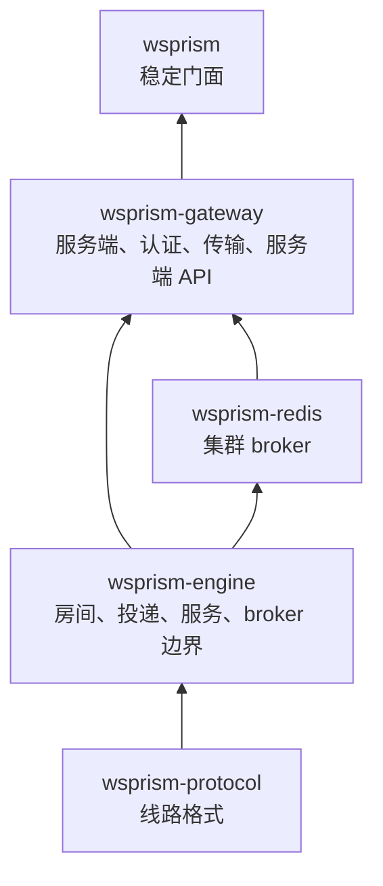
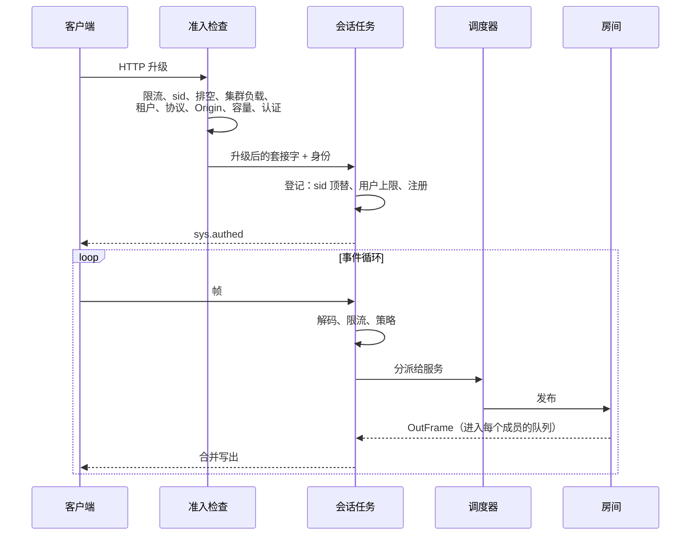

# 架构总览

本章跟随一条消息穿过网关，沿途介绍它经过的各个结构。主要写给贡献者，也适合想弄明白网关在负载下为何如此表现的运维人员。

## Crate 划分

- **`wsprism-protocol`** 只管线路格式：信封、Hot 帧、错误码和关闭码。没有运行时依赖，并经过模糊测试。
- **`wsprism-engine`** 是实时核心：会话上下文、房间、投递等级、Hot 槽位、服务 trait、调度器，以及 `Broker` 边界。它对 HTTP、axum 和配置格式一无所知。
- **`wsprism-redis`** 用 Redis 实现了 `Broker`。
- **`wsprism-gateway`** 是服务端：配置、准入、认证、WebSocket 传输、服务端 API、RPC 与连接代理、指标和日志，并负责构建二进制程序。
- **`wsprism`** 是用户依赖的门面，只重新导出稳定的部分。

这样划分的目的，是让每一层都能在不惊动下层的前提下被替换：新的传输层只涉及网关的传输模块；新的 broker 只需实现一个 trait；甚至可以不碰协议，在引擎之上另建一个服务端。

## 一条连接的一生

### 准入

准入是由一个个小检查串成的流水线。每个检查要么通过，要么返回一个带类型的拒绝，后者会转换成 HTTP 状态码、`Retry-After` 头和指标标签。检查按开销从小到大排列，认证排在最后，因此因其他原因被拒的连接，不会白白消耗一次签名校验、一次后端调用或一张一次性票据。新增规则只要插入一个步骤，不需要改动升级处理函数。

### 登记

升级完成后，会话把自己登记到所属租户和用户下面。相同 `sid` 的顶替、每用户上限（拒绝或挤掉最早的会话）、租户上限以及插入操作，都在该用户条目的同一把锁下完成，同一用户的并发连接不可能相互绕过。在集群中，由 Redis 脚本跨节点做出同样的裁决；如果要驱逐的会话在本地尚未登记，就先记下来，等它到达时再执行。

### 事件循环

每个会话运行在一个任务上，用一个 `select!` 循环同时等待五个来源：

- 客户端发来的帧；
- 由房间和服务填充的发送队列；
- Hot 槽位，按发送方和键保存最新的状态；
- 其他任务发来的关闭请求（踢下线、顶替、排空、慢消费者、空闲）；
- 连接内凭证续期的结果。

事件循环从不等待自己的发送队列。想发送消息的处理函数用 `try_send` 把帧放进队列；队列满了，就按投递等级处理。仅这一条规则，就杜绝了一整类"会话等待自己"的死锁。

房间成员关系只在会话自己的任务中变更，所以服务上下文可以以 `&mut` 形式传递，热路径上无需加锁。

### 入站

文本帧被解码成信封，经过连接级限流器和租户白名单检查，交给调度器，调度器按名称找到对应服务。二进制帧走同样的路径，只是按服务 ID 和操作码寻址。Hot 帧解码零拷贝，无论大小都在 20 ns 左右；一次策略检查耗时 5 到 18 ns。

发往后端的 RPC 调用在独立的任务中运行，后端再慢也不会卡住会话。

### 扇出

房间为每个成员直接持有一个指向其投递队列的句柄。因此，向房间发布只是遍历一遍句柄列表，既没有注册表查找，也没有字符串复制。消息只序列化一次，所有接收方共享同一份字节：服务端发往客户端的 WebSocket 帧不做掩码，每个成员收到的副本完全相同。

### 出站

写出端先从队列取出第一帧，再把已经在排队的帧（不超过批量上限）一并取出，用一次系统调用刷出。负载越高、每次投递的 CPU 开销越低，主要就是这种写合并的功劳。

写入阻塞超过 `writer_send_timeout_ms`，会话就会被关闭。计时器只在写入真正阻塞时才设置，从而省掉了每次写入都注册一个计时器的开销。

Hot 状态不经过队列。每个会话都有一张槽位表，为每个 `(sender, svc, key)` 保存最新的一帧；事件循环在收到信号时，或者在设置了 `hot_tick_hz` 时按 tick 清空这张表。于是慢读取方总能拿到最新状态，它能占用的内存也被表的大小限定。

### 传输边界

事件循环只通过 `SessionTx` 和 `SessionRx` 两个 trait 与套接字交互，知道 axum WebSocket 类型的模块只有一个。WebTransport 的实现将从这里接入；出站帧类型（`OutFrame`）很早就被设计成与传输无关，也是出于同样的考虑。

## 投递等级

| 等级 | 队列满时 | 用于 |
|---|---|---|
| Reliable | 接收方作为慢消费者被断开（4101），重连后借助历史续收 | Ext 消息、回复、在线状态事件 |
| Lossy | 只对该接收方丢弃，并计数 | 不带键的 Hot 帧、可丢弃的服务端发布 |
| 带键 Hot | 在槽位表中被更新的值取代 | 带键的 Hot 帧 |

这种不对称是有意为之。悄悄丢掉一条可靠消息会破坏顺序承诺，而客户端根本无从察觉；连接被关闭则是看得见的，借助历史消息恢复的代价也很低。

## Broker 边界

所有房间流量都经由 `Broker` trait 离开引擎。内存 broker 在本地投递；Redis broker 在此基础上增加了：

- **发件箱（outbox）**：发往 Redis 的帧队列，按租户分配份额，按序重试，满了或者最早的帧等太久就拒绝；
- 按房间的订阅，分散在多条订阅连接上；
- 会话、在线状态、票据和历史消息的共享存储。

引擎的顺序规则是针对 trait 而不是针对 Redis 编写的，测试也会在两种 broker 上运行同一批场景。Redis broker 的细节见[下一章](cluster-internals.md)。

## 每条连接的内存

空闲连接约占 17 KB 进程内存，房间类负载下为 18 到 28 KB。大部分来自 WebSocket 读缓冲区以及会话的任务和队列。最初的基线是空闲时约 28 KB，节省最多的两项改动是：把嵌套的并发集合换成每个会话自己的普通结构，以及让房间直接持有投递句柄。把全局分配器换成 mimalloc 也测过，但 CPU 没有任何收益，负载下内存反而最多翻倍，因此没有采用。曾有一个按会话创建的通道在不知不觉中让每条连接多占了 4 KB，所以现在只要空闲连接的单连接内存超过 18.5 KB，CI 就会失败。

## 错误与 panic

生产代码中没有 `unwrap`、`expect` 或 `panic!`，由 lint 强制保证。返回给客户端的错误使用固定集合中的错误码，不暴露内部原因。所有处理不可信输入的解析器（信封、Hot 帧、子协议头、Origin、`X-Forwarded-For`）都在 CI 中做模糊测试。
