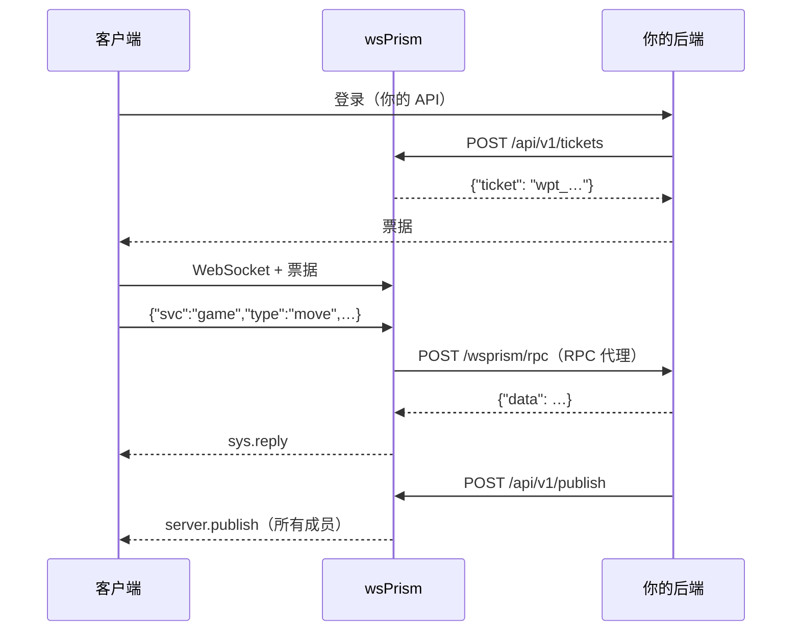

# 对接后端

wsPrism 的定位，是放在你现有的后端前面，后端用什么语言写都可以。两者之间双向都走普通的 HTTP：



- **后端调用网关**，用的是服务端 API：签发票据、发布消息、踢用户下线、查询在线状态。
- **网关调用后端**，用的是连接代理（决定能否接入）和 RPC 代理（客户端发给你的服务的请求）。

## 服务端 API

服务端 API 在独立的地址上监听，与公网 WebSocket 端口分开。请绑定到回环地址或内网，绝不能暴露在互联网上。

```yaml
gateway:
  api:
    listen: "127.0.0.1:8081"
tenants:
  - id: acme
    api_keys:
      - name: backend
        sha256: "3b4c…"     # printf %s "$KEY" | sha256sum
```

配置里只存每个密钥的 SHA-256。请求以 `Authorization: Bearer <key>` 携带密钥，由密钥决定租户：后端无法对自己没有密钥的租户做任何操作。建议每个后端服务各用一把密钥，并起一个能看懂的 `name`，轮换密钥和查日志都会方便很多。

下面简单介绍各个接口，完整规格见[服务端 API](../reference/server-api.md)。

### 发布消息

```bash
curl -X POST http://127.0.0.1:8081/api/v1/publish \
  -H "Authorization: Bearer $KEY" \
  -d '{"room":"match:42","data":{"event":"goal","by":"alice"}}'
# {"recipients": 12}
```

成员收到的是 `{"v":1,"svc":"server","type":"publish","room":"match:42","data":{…}}`。除非指定 `"qos": "lossy"`，Ext 发布都是可靠投递。请求体里改用 `hot` 字段，则发布的是二进制帧（见 [Hot 通道](hot-lane.md)）。

`recipients` 统计的是接收请求的那个节点上的成员数。在集群中，其他节点上的成员同样会收到消息，但不计入这个数字。200 表示消息已被接收并进入队列，并不表示已经送达。如果必须确认每个客户端都看到了某条消息，请发布到带历史的房间，再核对客户端上报的 offset。

正在关闭的节点、或者通往 Redis 的队列已满的节点，会返回 503 和 `Retry-After`。请换一个节点或经由负载均衡器重试。如果重试可能导致重要消息重复，请在消息里放一个 ID，让客户端能识别出来。

### 踢用户下线

```bash
curl -X POST http://127.0.0.1:8081/api/v1/disconnect \
  -H "Authorization: Bearer $KEY" \
  -d '{"user":"alice","reason":"account suspended"}'
# {"closed": 2}
```

不指定 `sid` 时关闭该用户的所有会话，指定时只关闭那一个。客户端会收到带有你给出原因的 `sys.kicked` 和关闭码 4007，SDK 看到这个码就不会重连。在集群中，这条命令会送达每个节点。

### 在线状态

```bash
curl http://127.0.0.1:8081/api/v1/rooms/match:42/presence -H "Authorization: Bearer $KEY"
# {"room":"match:42","users":["alice","bob"]}
```

### 票据

`POST /api/v1/tickets` 已在[认证与权限](authentication.md#一次性票据)中介绍过。

## RPC 代理

有了 RPC 代理，后端不用持有任何一个连接，就能响应客户端的请求。`svc:type` 与 `allow` 匹配的 Ext 消息会被转发到你的端点：

```yaml
tenants:
  - id: acme
    rpc:
      url: "http://10.0.0.5:9000/wsprism/rpc"
      allow: ["game:*", "shop:buy"]
      timeout_ms: 5000
      max_in_flight: 16          # 每条连接
      max_in_flight_total: 1024  # 整个租户
      secret_env: BACKEND_SECRET
    policy:
      ext_allowlist: ["room:*", "game:*", "shop:buy"]
```

这里出现了两份列表，缺一不可：`rpc.allow` 决定消息*发往哪里*，`ext_allowlist` 决定消息*是否被允许*。内置服务（`room`、`chat`、`sys`）不能路由到后端。

客户端的请求

```json
{"v":1,"svc":"game","type":"move","room":"match:42","seq":9,"data":{"x":3,"y":1}}
```

会变成

```json
POST /wsprism/rpc
Authorization: Bearer <BACKEND_SECRET>

{"tenant":"acme","user":"alice","sid":"tab-1","svc":"game","type":"move",
 "room":"match:42","joined":true,"data":{"x":3,"y":1}}
```

你的回复会这样转给客户端：

| 你的回复 | 客户端收到 |
|---|---|
| `200 {"data": …}` | 带有该 `data` 和 `reply_to: 9` 的 `sys.reply` |
| `200 {"error": {"code": "NOT_YOUR_TURN", "msg": "…"}}` | 带有该错误码的 `sys.error`（不符合 `[A-Z0-9_]{1,32}` 则为 `RPC_ERROR`） |
| 其他任何回复、超时或无响应 | `sys.error UNAVAILABLE`；你的响应体不会被转发 |

`user` 和 `sid` 取自已认证的会话，客户端无法伪造。默认情况下，指向本会话未加入房间的请求在到达你之前就会被拒绝（`NOT_ALLOWED`），所以 `"joined": true` 是可以信赖的事实。设置 `require_joined_room: false` 后，这类请求会带着 `"joined": false` 转发过来，此时房间只是客户端的一面之词。

会话从不等待后端。每次调用都在独立的任务里执行，其他消息照常流动，这意味着回复的先后可能与别的回复不同，客户端要靠 `seq` 对应。某条连接上未完成的调用超过 `max_in_flight` 时，会立即收到 `RATE_LIMITED`；整个租户超过 `max_in_flight_total` 时，收到 `RESOURCE_EXHAUSTED`。

一种常见的写法是：后端在回复调用方的同时，用 `/api/v1/publish` 把结果广播给整个房间。示例应用里的掷骰子就是这样做的。

## 网关如何调用你

连接代理和 RPC 代理在每个进程里共用一个 HTTP 客户端，它的行为刻意偏保守：

- 不跟随重定向，避免令牌被带到配置里没有写的主机上；
- 忽略环境变量中的 `HTTP_PROXY` 和 `HTTPS_PROXY`；
- 任何响应最多只读 1 MiB；
- 用操作系统的证书库校验 `https`。安装在主机上的私有 CA 会被信任；精简的容器镜像需要装 `ca-certificates`。

配置了 `secret_env` 时，网关会把该变量的值以 `Authorization: Bearer …` 发送，你的端点就能把网关和网络上的其他请求区分开。日志中的后端 URL 会去掉凭证，查询参数的值也会被遮盖。

## 改用 Rust 编写服务

如果连一次到后端的往返都嫌慢，比如在 Hot 通道上跑游戏逻辑，那就用 Rust 写服务，通过 `Gateway::builder` 注册。它运行在网关内部，可以直接访问房间。见 [Rust API](../reference/rust-api.md)。
