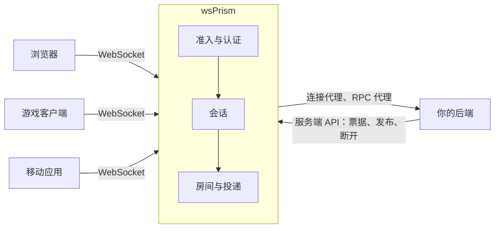

# 简介

**wsPrism** 是一个用 Rust 编写的实时网关。它部署在客户端和后端之间，专门处理普通 Web 服务器不擅长的那部分工作：几十万条长连接、房间、扇出、在线状态，以及在机器宕机时依然让这一切保持一致的种种细节。

后端照旧是普通的 HTTP 服务：决定谁能连进来、向房间发消息、响应请求。连接则交给 wsPrism 来维持。

## 为什么需要网关

请求-响应式的后端，是围绕"短任务、无共享状态的进程"来设计的。长连接恰恰相反：一条连接可能存活数小时，自身带有状态，所属房间里一有动静就得立刻被唤醒。把这些连接塞进应用服务器，等于把两类截然不同的扩展问题绑在了一起，而最后往往是连接这一侧决定了你要买什么样的机器。

wsPrism 把两者拆开：连接、房间和消息投递由一个专门的进程负责（规模大了可以是几个进程，通过 Redis 共享状态），业务逻辑留在原处。

## 它能做什么

- **一条连接，两条通道。** 聊天、指令这类请求式的消息走 JSON；每秒变化几十次、只有最新值才有意义的状态，走紧凑的二进制帧。
- **多租户。** 一套部署可以服务多个相互隔离的租户，每个租户有自己的认证方式、白名单、限流和资源上限。
- **贴合现有的认证体系。** 可以用后端签发的一次性票据、JWT（支持 JWKS 和密钥轮换）、回调后端的连接代理，或者自己写的插件。凭证可以在连接内续期，无需重连。
- **带历史的房间。** 断线重连的客户端会按顺序收到错过的消息；补不回来的时候，也会明确告诉它。
- **不隐瞒故障的集群。** 多个节点通过 Redis 共享房间、会话、在线状态和历史消息。故障一律显式处理：丢了消息就通知，失去身份的节点宁可自己停下也不去破坏状态。这些行为都用杀节点、断网络、重启 Redis 的方式实际测过。
- **用数据说话的性能。** 在同一台机器上与 Centrifugo 对比：每条连接的内存在负载较重的小房间场景下只有对方的四分之一到三分之一，在 5 万条基本空闲的连接下约为一半；中低负载下每次投递的 CPU 开销更低；每秒投递两百万条消息时，p99 延迟仍在 10 ms 以内。以上数字针对的是在服务器之前终止 TLS 的明文 WebSocket；如果在同一台主机上用 nginx 终止 TLS，自带 TLS 的 Centrifugo 更占优。测量方法以及对比在哪些方面并不公平，见[基准测试](project/benchmarks.md)。

## 适用场景

连接多、存活久、需要服务端主动推送的应用都很适合：多人游戏与状态同步类应用、协作工具、实时看板、聊天与通知、交易界面等。如果你在意单连接内存和尾延迟，或者宁愿运维一个行为可预期的独立进程，也不想在每个后端服务里各自处理连接，wsPrism 会是不错的选择。

它不是消息队列，不是数据库，也不是通用 RPC 框架；它不兼容 Socket.IO、Pusher 等现有协议。客户端通过 JavaScript SDK 或自行实现的客户端使用 wsPrism 协议。

## 当前状态

wsPrism 即将发布第一个公开版本（0.1.0）。单节点网关功能完整，测试充分。Redis 集群功能也已齐备，并通过了本文档中描述的各项故障测试，但在真正经过生产环境检验之前，仍标记为**实验性**。后续计划见[路线图](project/roadmap.md)。

## 接下来读什么

- [设计理念](philosophy.md)：各项决策背后的原则。
- [快速上手](getting-started.md)：几分钟内跑起网关并接入客户端。
- [核心概念](guide/concepts.md)：整套指南里用到的术语。
